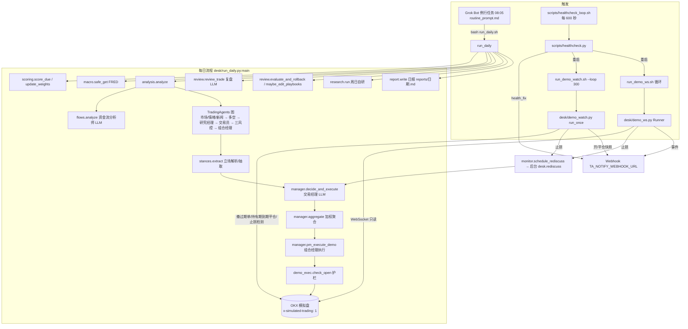

# ta-desk 交易台运行逻辑与完整链路

> 编写时间：2026-10-22 21:20（北京时间，UTC+8）。全部依据 `/workspace/ta-desk` 当前代码、`config.yaml`、启动脚本、README 与 `state/` 文件结构核对；未改代码、未重启进程、未调用 AI、未下单；`state/secrets.env` 未打开。
> 记号：`文件:函数` 表示逻辑所在位置；行号以本次阅读时为准。代码与 README/配置注释/用户描述不一致时，以代码为准，并在“差异”处标出。

## 目录

1. 总览（架构图、目录、常驻进程与定时任务、当前进程号）
2. 角色与模型（全部角色、模型、中转站、每个角色的输入数据）
3. 每日流程完整链路（取数、讨论顺序、加权汇总、方向/仓位/杠杆/入场/止损止盈、否决、护栏、下单）
4. 旧纸面仓与模拟盘的关系，本地纸面账本状态
5. 盯盘：demo_watch 与 demo_ws
6. 健康检查
7. 通知链路
8. 评分、调权、复盘、手册修订
9. 每周自研
10. 日报结构
11. 成本
12. 失败与降级处理汇总表
13. 已知风险、未实现、代码与设计不一致、待用户决定事项
14. 自检：desk/ 与 scripts/ 文件覆盖清单
附录：state/ 状态文件结构

---

## 1. 总览

### 1.1 架构图

### 1.2 目录结构（只列与运行有关的部分）

| 路径 | 作用 |
|---|---|
| `config.yaml` | 全部参数（执行场所、模型、护栏、聚合阈值、打分、学习、自研） |
| `run_daily.sh` | 每日入口：加载 `state/secrets.env` 后 `python -m desk.run_daily`，输出 tee 到 `logs/run-<日期>.log` |
| `run_demo_watch.sh` | 模拟盘轮询：`--loop 300` 常驻；每轮 `timeout -k 10 150 python -m desk.demo_watch --once`，日志 `logs/demo-watch-<日期>.log` |
| `run_demo_ws.sh` | WebSocket 常驻：死循环拉起 `python -m desk.demo_ws`，退出后 sleep 10 再起；日志 `logs/demo-ws-<日期>.log` |
| `run_monitor.sh` | 旧纸面盯盘（已停用，脚本头部注明“不要再启动”） |
| `scripts/healthcheck_loop.sh` | 每 600 秒执行一次 `timeout 120 python scripts/healthcheck.py`，日志 `logs/healthcheck.log` |
| `desk/` | 业务代码（见第 14 节逐文件清单） |
| `scripts/` | 健康检查与一次性运维脚本 |
| `playbooks/<角色>/vNNN.md + meta.json` | 角色手册与版本元数据（12 个 ROLE_KEYS 角色 + `trade_manager` 人工手册） |
| `research/` | 每周自研登记表与报告 |
| `reports/` | 日报 |
| `state/` | 运行状态（结构见附录） |
| `vendor/TradingAgents` | TradingAgents v0.7.0 源码（不改源码，运行时打补丁） |
| `/workspace/ai-trader` | 外部复用：`okx_client.py`（公共行情）、`store.py`/`guardrails.py`（旧纸面账本）、`backtest.py`（回测） |
| `tests/` | 单元测试（13 个文件） |

### 1.3 常驻进程、定时任务与触发方式

| 任务 | 触发方式（以代码为准） | 是否调 AI |
|---|---|---|
| 每日流程 `desk.run_daily` | 本机**没有 cron**（`healthcheck_loop.sh` 注释写明“本机无 cron/crontab”）。由 Grok Bot 例行任务按 `routine_prompt.md` 在北京时间 08:05 执行 `bash run_daily.sh`。`config.yaml schedule.run_time: "08:00"` 在代码中**没有任何地方读取** | 是 |
| 每周日自研 `desk.research.run` | 不是独立进程：在 `run_daily.py:main` 第 5b 步调用；`research.py:run` 判断 `now.weekday()==research.weekday(6=周日)` 且 `research/last_run.json` 的周号与本周不同才运行；`--research` 或 `python -m desk.research --force` 可强制 | 是 |
| demo_watch 轮询 | `run_demo_watch.sh --loop 300`：每轮结束 sleep 300 秒（实际间隔 = 本轮耗时 + 300 秒） | 否 |
| demo_ws WebSocket | `run_demo_ws.sh` 常驻；单实例锁 `state/demo_ws.lock` | 否（止损时会后台拉起再讨论，再讨论调 AI） |
| 健康检查 | `scripts/healthcheck_loop.sh`：`timeout 120` 跑一次后 sleep 600 | 否 |
| 止损后再讨论 `desk.rediscuss` | 由 `monitor.schedule_rediscuss` 用 `subprocess.Popen(start_new_session=True)` 后台启动，日志 `logs/rediscuss-<日期>.log` | 是 |
| Webhook 通知 | 事件驱动：demo_ws 推送事件、demo_watch 持仓快照变化、healthcheck 修复（见第 7 节） | 否 |

### 1.4 当前进程（2026-10-22 21:1x 北京时间 `ps` 实测）

| PID | PPID | 启动时间（北京） | 命令 |
|---|---|---|---|
| 328341 | 52 | 10-22 21:07:10 | `bash run_demo_watch.sh --loop 300` |
| 328342 | 52 | 10-22 21:07:10 | `bash run_demo_ws.sh` |
| 328354 | 328342 | 10-22 21:07:10 | `.venv/bin/python -m desk.demo_ws` |
| 328343 | 52 | 10-22 21:07:10 | `bash scripts/healthcheck_loop.sh` |

没有 `run_monitor.sh`、`desk.monitor`、`run_daily`、`rediscuss` 进程在运行。demo_watch 的 python 子进程每轮短暂存在，`ps` 时刻不一定看得到。`state/demo_ws_heartbeat` 最近一次为 21:15:08，demo_watch 日志最近一轮 21:12:15（模拟盘持仓 2，条件单 0，权益基准 101898.76，实时 102303.59）。

---

## 2. 角色与模型

### 2.1 角色登记（`desk/roles.py:ROLES`）

| 键 | 中文名 | TradingAgents 工厂 | 初始权重 | 是否投票（`manager.VOTERS`） |
|---|---|---|---|---|
| market | 市场分析师 | create_market_analyst | 1.0 | 是 |
| sentiment | 情绪分析师 | create_sentiment_analyst（config `analysts` 里叫 `social`） | 1.0 | 是 |
| news | 新闻分析师 | create_news_analyst | 1.0 | 是 |
| flows | 资金流分析师 | 无（本系统新增，在 TradingAgents 图之前单独跑） | 1.0 | 是 |
| bull | 多头研究员 | create_bull_researcher | 1.0 | 是 |
| bear | 空头研究员 | create_bear_researcher | 1.0 | 是 |
| research_manager | 研究经理 | create_research_manager | 1.5 | 是 |
| trader | 交易员 | create_trader | 1.0 | 是 |
| aggressive | 激进风控 | create_aggressive_debator | 0.75 | 是 |
| conservative | 保守风控 | create_conservative_debator | 0.75 | 是 |
| neutral | 中性风控 | create_neutral_debator | 0.75 | 是 |
| portfolio_manager | 投资组合经理 | create_portfolio_manager | 2.0（代码里仍有，但不用） | **否**：只执行，不投票、不进 `weights.json`（`manager.weights`、`scoring.weight_roles`） |
| trade_manager | 交易经理 | 无（`manager.decide_and_execute` 单独调用） | `TM_INIT_WEIGHT=1.0` | 是（作为投票角色之一） |
| reviewer | 复盘会/手册修订 | 无（`review.py`） | 不投票 | 否 |
| extractor | 立场抽取 | 无（`stances.extract`） | 不投票 | 否 |

`state/weights.json` 当前值：market/sentiment/news/flows/bull/bear/trader/trade_manager 1.0，research_manager 1.5，三风控 0.75（尚无任何打分，全部是初始值）。

### 2.2 模型分配（`config.yaml role_models` + `desk/providers.py:resolve/build`）

| 角色 | provider | 模型 | tier（回退用） |
|---|---|---|---|
| market | deepseek | deepseek-flash | quick |
| sentiment | grok | grok-4.7 | quick |
| news | deepseek | deepseek-flash | quick（注释：GPT 不稳定，10-20 临时改） |
| flows | deepseek | deepseek-flash | quick |
| bull | grok | grok-4.7 | quick |
| bear | deepseek | deepseek-flash | quick（原 GPT） |
| research_manager | deepseek | deepseek-flash | deep |
| trader | deepseek | deepseek-flash | quick |
| aggressive | grok | grok-4.7 | quick |
| conservative | deepseek | deepseek-flash | quick（原 GPT） |
| neutral | deepseek | deepseek-flash | quick |
| portfolio_manager | deepseek | deepseek-flash | deep（原 GPT） |
| trade_manager | grok | grok-4.7 | deep |
| reviewer | deepseek | deepseek-flash | deep |
| extractor | deepseek | deepseek-flash | quick |

- 中转站：`providers.grok/gpt` 均为 `kind: relay`，地址取环境变量 `RELAY_BASE_URL`，缺省 `https://<LLM_RELAY_HOST>/v1`；grok 用 `XAI_API_KEY`，gpt 用 `OPENAI_API_KEY`；以 `openai_compatible` 客户端创建，`timeout=180`（`providers.build`）。DeepSeek 用 `llm.default_base_url=https://api.deepseek.com`（可被 `TA_LLM_BASE_URL` 覆盖），密钥 `TA_LLM_API_KEY` 或 `DEEPSEEK_API_KEY`。
- 回退：中转缺密钥或地址时，回退 DeepSeek 的 `deep_model/quick_model`（两者当前都为 `deepseek-flash`），并记入 `providers.FALLBACKS` 写进日报“模型分配”（`providers.resolve`）。
- 覆盖：`TA_MODEL_<角色大写>` 可临时换某角色模型；`TA_DEEP_MODEL/TA_QUICK_MODEL` 覆盖深/快模型（`settings.load_config`）。
- 接口实际返回的模型名：用量日志里 Grok 记为 `grok-4.7-build`，gpt 角色当前全部改回 DeepSeek，10-21 之后用量里已无 `gpt-6.1-sol`。
- TradingAgents 内部其余调用（记忆反思等）走 `llm` 段 DeepSeek 深/快模型（`llm.ta_config`）。
- 注入方式：`roles.install` 把 TradingAgents `graph.setup` 里每个 `create_*` 工厂包一层，按 `role_models` 换模型，并用 `roles.PlaybookLLM` 在每次调用前把“角色手册 + 本角色专属简报”追加到系统提示（`PlaybookLLM._inject`）。

### 2.3 每个角色的输入数据

| 角色 | 输入（以代码为准） |
|---|---|
| 公共 | TradingAgents 自带提示词 + 本角色手册（`playbooks/<角色>/当前版本`，含固定的【立场】行格式要求 `roles.STANCE_SPEC`）+ 组合上下文 `analysis.portfolio_ctx`（现金、持仓） |
| market 市场分析师 | TradingAgents 行情工具；价格数据被 `okx_data.install` 替换为 OKX 1Dutc 日线（`okx_load_ohlcv`，420 根，失败回退 Yahoo）；额外工具 `tools.run_backtest`（OKX 历史日线/4H/1H 最多 1500 根，只用分析日之前数据，做多回测，含样本外 30%，费 0.1%）；专属简报：一段说明 run_backtest 用法的文字（`analysis.analyze`） |
| sentiment 情绪分析师 | TradingAgents 自带 Reddit/StockTwits；专属简报：`state/x_feed/<日期>/<币>.md`（前 6000 字，由例行任务预先采集；文件不存在则无）。当前只有 10-20、10-21 两天的 x_feed，10-22 没有 |
| news 新闻分析师 | TradingAgents 新闻工具，全局新闻查询词在 `llm.ta_config.global_news_queries`（比特币监管 ETF 资金、美联储利率通胀、稳定币黑客清算）；专属简报：FRED 宏观中文摘要 `macro.brief`（DGS10、DGS2、DFF、DTWEXBGS、T10YIE、CPIAUCSL 同比、VIXCLS，各给最新值、日期、较 1 周/1 月变化），只注入 news |
| flows 资金流分析师 | `flows.fetch`：OKX 公共接口资金费率（当前 + 最近 100 期历史）、永续持仓量 oiUsd、多空账户比（1D）、全合约持仓量/成交额（1D）、主动买卖量（1D），DefiLlama 稳定币总流通（最近 40 天）；ETF 资金流与链上净流入未接入（brief 中写明）。用 `PlaybookLLM` 包装调用一次 LLM 出 300~600 字报告 |
| bull / bear / research_manager / trader / portfolio_manager | TradingAgents 辩论/汇总上下文 + 专属简报：资金流分析师报告（`roles.FLOWS_READERS`） |
| aggressive / conservative / neutral | TradingAgents 风控辩论上下文（无专属简报） |
| trade_manager 交易经理 | `manager._prompt`：OKX 日线行情摘要（`market_ctx`：最新价、最近日线收盘、5 日/20 日涨跌、ATR14、20 日高低）、账户（权益基准、实时权益、现金、敞口、单笔/总名义/当日亏损金额上限、最多仓数）、本币持仓、12 个角色立场与权重、不含交易经理自身的共识 S、组合经理最终意见末 3000 字、交易员方案末 2000 字、条件入场字段说明与字段一致性要求。**不注入 `playbooks/trade_manager/` 手册**（见第 13 节） |
| extractor 立场抽取 | 只对“立场行与结构化输出都解析不到”的角色，把其发言末 6000 字交给 LLM 结构化抽取（`stances.extract`） |
| reviewer 复盘 | 平仓交易数据 + 当时各角色观点表 + 交易经理理由与失效条件（`review.review_trade`）；手册修订时为当前手册、成绩单、近期失误、复盘教训（`review.maybe_edit_playbooks`） |
| 研究（周日） | market/sentiment/news/flows 四个分析师用各自模型，按 `research.role_features` 菜单提假设（`research.propose`） |

---

## 3. 每日流程完整链路（`desk/run_daily.py:main`）

### 3.1 步骤顺序

1. `settings.load_config` → `ledger.assert_paper`（`mode` 必须是 paper，否则抛异常拒绝运行）→ `ledger.migrate_to_swap`（旧现货账本幂等迁移）→ 若 `demo_exec.is_demo`，`ledger._demo("startup")` 调 `okx_demo.verify` 自检（失败只记 `verify_failed`，之后任何下单函数 `_require` 都会拒绝）。
2. 检查 LLM 密钥（`llm.prepare_env`），缺失返回 2；`--mock` 用 `FakeChatModel` 演练。
3. `roles.ensure_playbooks` 补齐缺失手册；创建 `UsageTracker`。
4. 紧急停止：`ledger.kill_switch_path` = `store.HOME / "KILL"`，`store.HOME` 被 `settings.ai_trader_modules` 设为 `state/ledger`，所以**实际路径是 `state/ledger/KILL`**。run_daily 只打印提示；真正的拦截在护栏 `check_open`（第 84 行 `st_note` 赋值后未被使用）。
5. 盯市：只在非 demo 模式调用 `ledger.mark_to_market`；demo 模式跳过。
6. 打分与调权：`scoring.score_due` → `scoring.update_weights`（第 8 节）。
7. 宏观：`macro.safe_get`（按日缓存 `state/macro_cache.json`）。
8. 逐币（BTC、ETH、SOL 顺序，`--coins` 可筛）：取三币最新价 → `demo_exec.book` → `analysis.analyze` → `stances.extract` → `manager.decide_and_execute` → `scoring.record_stances`。单币异常写入 errors，不影响其他币。
9. 复盘：`demo_trades.review_candidates`（本地纸面账本 closed + 模拟盘 positions-history 已平仓），已有 `state/reviews/<trade_id>.json` 的跳过，其余逐笔 `review.review_trade`。
10. 手册：`review.evaluate_and_rollback` → `review.maybe_edit_playbooks`。
11. 自研：`research.run`（周日）。
12. 写 `state/usage/run-<RUN_ID>.json`，再取一次三币最新价，`report.write` 写日报。返回码：有错误且没有任何决策时为 1，否则 0。

### 3.2 取数（真实来源）

| 数据 | 来源与函数 |
|---|---|
| 日线 K 线 | OKX 公共 `get_candles/get_history_candles`（经 `/workspace/ai-trader/okx_client.OKXClient`，`creds=None` 只用公共接口），bar `1Dutc`，只保留 `confirm=="1"` 已收盘，缓存 600 秒，失败重试 4 次（`okx_data._candles/_retry`） |
| 最新价 | OKX ticker `last`（`okx_data.last_price`） |
| 资金费率 | `/api/v5/public/funding-rate`（`okx_data.funding_rate`，仅旧纸面账本资金费估算）；资金流分析师另用 `flows.fetch` |
| 衍生品/资金流 | OKX `public/funding-rate`、`public/funding-rate-history`、`public/open-interest`、`rubik/stat/contracts/long-short-account-ratio`、`rubik/stat/contracts/open-interest-volume`、`rubik/stat/taker-volume`；DefiLlama `stablecoins.llama.fi/stablecoincharts/all`（`flows.fetch`，每个接口重试 3 次、缓存 600/3600 秒，单项失败记入 errors 不中断） |
| 新闻 | TradingAgents 新闻工具（vendor 内实现） |
| 情绪 | TradingAgents Reddit/StockTwits + `state/x_feed` |
| 宏观 | FRED `api.stlouisfed.org/fred/series/observations`，`FRED_API_KEY`，timeout 15（`macro.fetch_observations`） |
| 账户/持仓/挂单 | OKX 模拟盘私有接口：`/account/balance`、`/account/positions`、`/trade/orders-algo-pending`（`demo_exec.book`） |

### 3.3 TradingAgents 讨论顺序

由 vendor `graph/setup.py` 与 `conditional_logic.py` 决定，本系统配置 `max_debate_rounds=1`、`max_risk_discuss_rounds=1`：

资金流分析师（本系统，先跑）→ 市场分析师 → 情绪分析师 → 新闻分析师（`analysts: [market, social, news]`，不使用 fundamentals）→ 多头研究员 ↔ 空头研究员（`count >= 2×1` 结束，即各 1 次）→ 研究经理 → 交易员 → 激进风控 → 保守风控 → 中性风控（`count >= 3×1` 结束）→ 投资组合经理 → 结束。之后本系统做：立场抽取 → 交易经理 → 加权聚合 → 组合经理执行。

### 3.4 立场解析（`desk/stances.py:extract`）

- 每个角色文本来源 `role_texts`：market/sentiment/news 报告、`_flows_report`、bull/bear 辩论历史、`investment_plan`、`trader_investment_plan`、三风控历史、`final_trade_decision`。
- 优先解析最后一条 `【立场】方向=…；目标价=…；止损价=…；置信度=…；周期=N；入场价=…；入场条件=涨到/跌到/现价`（`parse_stance`）。
- 研究经理/交易员/组合经理/情绪分析师另有结构化格式解析（`parse_structured`：Recommendation/Action/Rating 映射 buy 0.8、overweight 0.6、hold 0.5 中性、underweight 0.6、sell 0.8）；两者都有时方向以结构化为准，价位用立场行。
- 两者都没有才调用 extractor LLM；抽取失败的角色记为中性、置信 0。无发言记为中性、置信 0。周期缺省用 `scoring.horizon_days=5`。

### 3.5 加权汇总（`desk/manager.py:consensus / aggregate`）

- 投票集合 `VOTERS` = ROLE_KEYS 去掉 portfolio_manager，加上 trade_manager。
- 方向数值 `DIR_NUM`：bullish=+1，bearish=−1，neutral=0，close=0。
- **共识公式**（`consensus`）：`S = Σ w_i × 方向_i × 置信度_i / Σ w_i`，求和范围是当前有立场的投票角色，分母是这些角色的权重和（不乘置信度）。
- 交易经理提示词里展示的 S 不含交易经理（`decide_and_execute` 第 380 行）；聚合时 `st["trade_manager"]=tm_stance(...)` 已加入（交易经理缺席时不加），所以最终 S 含交易经理一票。
- **方向**：`S > consensus_threshold(0.1)` 做多，`S < −0.1` 做空，否则不交易；还要求至少一个同向且置信度 > 0 的投票角色（`bulls`），否则 `buy=False`。
- **入场价**：同向角色的 `entry_px`（入场条件为 now 且没写价时用最新价）剔除不在 (0.5×现价, 1.5×现价) 的离谱值后，按 `w_i × 置信度_i` 加权平均；没有则用现价。距现价 ≤ `pending.immediate_band_pct=0.3%` 视为现价成交（condition=now，入场价改为现价），否则高于现价为 gte、低于为 lte。
- **止损**：同向角色中止损在正确一侧（做多低于入场、做空高于入场）的 `stop`，按 `w×置信度` 加权平均；没有则为空。
- **止盈**：同向角色中目标在正确一侧的 `target` 加权平均。
- **周期**：同向角色 `horizon_days` 加权平均，四舍五入后夹在 1~30 天，缺省 5。
- **仓位（保证金 % 权益基准）**：`cap = min(manager.max_size_pct=20, guardrails.max_position_pct=20) = 20`；`size = cap × min(1, |S| / full_size_consensus(0.6))`；若 `|S| < half_size_below(0.3)` 再减半。例：|S|=0.2 → 20×0.333/2 ≈ 3.33%；|S|=0.45 → 15%；|S|≥0.6 → 20%。
- 交易经理结构化输出里的 `size_pct`、`entry_size_pct`、`stop_loss`、`entry_trigger_px` **不直接决定下单数值**，只通过它那一票的方向/置信/入场价/止损参与加权；交易经理直接决定的只有：杠杆、条件单有效期、理由文本、已有持仓时的 sell/reduce/new_stop、以及否决/缺席。

### 3.6 杠杆（`manager._levfix`）

`lev = clip(交易经理 leverage, 1, swap.leverage_max=5)`（交易经理没给按 1）；若有止损，循环检查：做多 `止损 ≤ 强平价` 或做空 `止损 ≥ 强平价` 时每次降 0.5 倍，最低 1 倍。强平价近似 `ledger.liq_price`：多 = 入场×(1−1/杠杆+0.005)，空 = 入场×(1+1/杠杆−0.005)。`guardrails.leverage: 1` 与 `allow_leverage: false` 在代码中未被读取。

### 3.7 交易经理否决/缺席（`manager.tm_status`、`tm_stance`、`pm_execute_demo`）

- 缺席 absent：交易经理 LLM 调用异常。这一票不计入共识；本币不开新仓、不挂条件单，**不撤**旧条件单；`final_action="hold(交易经理缺席)"`。
- 否决 veto：置信度 ≤ 0；或无持仓时 sell/reduce；或 action=hold 且给了 entry_side+entry_trigger_px 但 `entry_size_pct` 显式 ≤ 0；或方向投票为中性（action=hold 且未给完整条件入场）。否决时不下现价单、不挂条件单，`cancel_pending_on_new_decision=true` 时撤该币旧条件单（受保护的不撤），`final_action="hold(交易经理否决)"`。
- go：其他情况。action=hold 但给了条件入场计划算有方向（日报标“动作标签与方向投票不一致”，`tm_label_mismatch`）；有持仓时的 sell/reduce 方向记为 close，照常执行平仓/减仓。
- 注意判定顺序：`pm_execute_demo` 先看“是否已有持仓”，再看 veto/absent。已有持仓时即使交易经理否决，也只按持仓分支处理（撤该币条件单、可平/减/改止损）。

### 3.8 组合经理执行（`manager.pm_execute_demo`，demo 模式）

1. 该币是旧纸面仓（legacy）：不操作。
2. 该币有模拟盘持仓：交易经理 sell → `demo_exec.close`（`/trade/close-position`，autoCxl）；reduce → `demo_exec.reduce`（比例夹在 0.1~0.9，reduceOnly 市价，按剩余张数重挂止损止盈 `_replace_close_algos`）；共识支持开仓也不加仓/不反手；最后撤该币条件单。action 以 hold 开头且给了 `new_stop` → `demo_exec.move_stop`（`decide_and_execute` 第 411 行）。
3. 否决/缺席：见 3.7。
4. 聚合不支持入场：撤该币条件单（原因“新决策不支持入场”）。
5. 支持入场：没有有效止损 → 拒绝；`size×权益基准/100 < min_order_usd(10)` → 拒绝；condition=now → 先撤该币条件单，再 `demo_exec.open_now`；否则 `demo_exec.place_trigger` 挂条件单，有效期 = 交易经理 `entry_expire_hours` 或 `pending.default_expire_hours=24`。
6. 任何异常写 `demo_events.jsonl` 的 `exec_error`，`final_action="hold(执行失败)"`。

### 3.9 护栏（`demo_exec.check_open`，数据来自模拟盘）

权益基准 `equity`：`execution.equity_basis=initial` → `state/demo_account.json.initial_equity_usdt = 101898.76`（`demo_exec.basis_equity`）。

| 护栏 | 规则与当前数值 |
|---|---|
| KILL | `state/ledger/KILL` 存在禁止开仓（配置注释写 `state/KILL`，与代码不符） |
| 品种池 | 只允许 BTC/ETH/SOL-USDT-SWAP |
| 杠杆上限 | 1 ≤ 杠杆 ≤ 5 |
| 单笔保证金 | 保证金 = 名义/杠杆 ≤ 权益 × 20%（≈ 20379.75 USDT） |
| 最小下单 | 名义 ≥ 10 USD |
| 最多持仓 | 现有持仓数（含旧纸面仓）+ 其他币条件单的币种数 ≥ 3 则拒绝 |
| 每币一仓 | 该币已有持仓（含旧纸面仓）拒绝；`open_now` 另查该币是否仍有条件单（含受保护的） |
| 总名义 | 现有持仓名义 + 其他币条件单名义（张数×ctVal×触发价）+ 本单名义 ≤ 权益 × `max_total_notional_pct` 180%（≈ 183417.77 USDT），不随杠杆上限变化 |
| 止损必填 | 多单止损必须低于入场，空单必须高于入场 |
| 止损距离 | ≤ `max_stop_loss_pct` 15% |
| 止损先于强平 | 多单止损 > 强平价，空单止损 < 强平价 |
| 当日亏损 | 模拟盘 `positions-history` 中 uTime ≥ 北京时间今日 0 点的 `realizedPnl` 合计 ≤ −初始权益×5%（≈ −5094.94）则禁止开仓；接口失败时按 0 处理 |
| 每日下单数 | 2026-10-23 起取消：`max_orders_per_day: 0` 表示不限；仅当该值 > 0 时，今日 `open_ok` + `trigger_placed` 次数达到上限才拒绝 |
| 止损只能收紧 | `demo_exec.move_stop`：`manager.allow_stop_widen=false` 时多单止损不能下移、空单不能上移；有止损算法单用 `amend-algos` 改，没有则重挂 |

### 3.10 下单到 OKX 模拟盘（确认无实盘逻辑）

- 所有私有请求都走 `desk/okx_demo.py:_request`：只读 `OKX_DEMO_API_KEY/OKX_DEMO_SECRET_KEY/OKX_DEMO_PASSPHRASE`，缺一即抛 `DemoError`，不回退实盘密钥；请求头硬编码 `x-simulated-trading: 1`；`BASE_URL=https://www.okx.com`（模拟盘与实盘同域名，靠该请求头区分）。
- `okx_demo.verify` 启动自检 `/api/v5/account/config`；`demo_exec._require` 在每个下单函数入口检查，自检失败拒绝下单。
- WebSocket 只连 `wss://wspap.okx.com/ws/v5/{private,business}`，模块加载时 assert 域名含 `wspap.okx.com`（`demo_ws.URLS`）。
- `ledger.assert_paper`：`mode` 不是 paper 一律抛异常；`mode=live` 且有 `state/LIVE_APPROVED` 也抛“当前版本不含实盘下单代码”。代码中没有使用实盘私钥的路径；`okx_data` 用的 ai-trader 客户端 `creds=None` 只访问公共行情。
- `demo_exec.is_demo` 在数据目录不是代码目录时（测试）一律返回 False，绝不访问模拟盘。

### 3.11 现价单、条件单、触发后限价

- 现价（`demo_exec.open_now`）：张数 = `size% × 权益基准 × 杠杆 / 现价 / ctVal`，按 lotSz 向下取整，低于 minSz 拒绝；`set-leverage`（逐仓，posMode=long_short_mode 时带 posSide）→ 市价单 + `attachAlgoOrds`（止损/止盈触发价 last，`slOrdPx/tpOrdPx=-1` 即触发后市价）；登记 `demo_orders.json positions[inst].deadline = 现在 + 周期天数`；事件 `open_ok`。
- 条件单（`place_trigger` → `submit_trigger`）：先用触发价算张数并过护栏（护栏视图里去掉本币旧条件单）；通过后撤本币旧条件单（受保护的不撤，仍有剩余则返回“该币已有受保护的条件单，不替换”）；OKX `ordType=trigger`，`triggerPxType=execution.trigger_px_type=last`，附带止损止盈。
- 触发后限价（`execution.entry_limit.enabled=true`）：`orderPx` = 做多 触发价×(1−0.1%)，做空 触发价×(1+0.1%)，按 tickSz 四舍五入（`demo_exec.entry_limit_px`）；登记 `state/ledger/entry_limit.json`（`entry_limit.register`）。`enabled=false` 时 `orderPx=-1`。
- 限价超时（`entry_limit.check_timeouts/_step`，demo_watch 每轮调用，非阻塞文件锁）：状态机 armed → triggered（读算法单历史 effective 的 ordId 与 triggerTime，或 demo_ws 先记的触发时间）→ 超过 `timeout_minutes=3` 未完全成交 → cancelling（撤子单）→ 剩余张数：`fallback_market=true` 且通过 `_guard`（只查 KILL 与当日亏损）→ filling（固定 clOrdId 市价补单，重入先查单防重复；一点没成交则补单附带原止损止盈）→ 部分成交时 protecting：等补单终态后按总持仓张数先挂新 OCO/conditional（reduceOnly）再撤旧的，避免裸仓 → done。护栏拦截或 `fallback_market=false` 时只撤单并保护已成交部分。
- 当前 `entry_limit.json` 三条记录全部 done：ETH 4026779893353574400（algo_canceled）、SOL 4026779985963827200（filled）、ETH 4027943060322545664（filled）。

### 3.12 pending.mode auto/confirm

- `pending.mode` 只在旧纸面盯盘 `desk/monitor.py:process_pending` 中使用：auto 触发即纸面成交；confirm 在触发或接近触发（`near_pct=0.3%`）时用 `monitor.CONFIRM` 再问一次交易经理（quick tier，role=trade_manager）。
- **demo 模式下 mode 不起作用**：条件单挂在 OKX，由交易所按最新价自动触发，相当于 auto，没有 confirm 流程。`pending.bar/mark_bar/near_pct` 也只用于旧纸面盯盘。demo 模式实际用到的 pending 参数只有 `immediate_band_pct`、`default_expire_hours`、`rediscuss_after_stop`、`rediscuss_cooldown_hours`。

---

## 4. 旧纸面仓（BTC/ETH）与模拟盘的关系

- 旧纸面账本：ai-trader 格式 `state/ledger/journal/trades.csv`、`orders.jsonl`，合约元数据 `state/ledger/positions_meta.json`，账户 `state/ledger/account.json`（`ledger.py`）。
- 当前状态（只读核对）：`trades.csv` 只有表头（0 笔），`orders.jsonl` 0 条，`positions_meta.json` 为空，`pending_entries.json` 为空；`account.json` 为 initial 1000、cash 1000，并带 `retired` 字段：“2026-10-20 22:39 本地纸面账本停用，旧仓已删除，备份在 state/archive/paper-ledger-20261020”。
- 所以 README、`demo_exec.py` 文档串、`manager.pm_execute_demo` 与 `run_daily.py` 注释里说的“两个旧纸面仓（BTC/ETH）由旧仓盯盘管理、只计数不操作”目前**已无实际持仓**；相关代码路径（`demo_exec.book` 合并 `ledger.book` 的 legacy 持仓、护栏计数、`pm_execute_demo` legacy 分支）仍保留但不会命中。
- 旧仓盯盘 `run_monitor.sh` 已按用户要求停用；`desk/monitor.py` 仅保留 `schedule_rediscuss` 供 demo_watch/demo_ws 调用。
- 复盘仍会读取：`demo_trades.paper_trades` 读当前账本与 `state/archive/paper-ledger-*/journal/trades.csv`，用于 ETH 补单仓（`eth_backfill_ok` 事件）关联原 `signal_id`。
- 模拟盘：`demo_account.json` 记录初始权益 101898.76 USDT（10-20 22:35 现货市价卖出换算，手续费 0.1%）。当前模拟盘 2 个持仓（`demo_orders.json positions`）：ETH-USDT-SWAP 空（D-20261021-ETH，来自条件单 4027943060322545664，到期 2026-10-27 21:05:29），SOL-USDT-SWAP 空（D-20261020-SOL-2，来自受保护条件单 4026779985963827200，到期 2026-10-28 23:38:42）；条件单 0 张。

---

## 5. 盯盘

### 5.1 demo_watch（`desk/demo_watch.py:run_once`，每轮不调 AI）

0. 自检失败本轮不做任何事。
1. 限价入场超时检查 `entry_limit.check_timeouts`（见 3.11）。
2. 条件单：对登记表 `triggers` 中每张单
   - 仍在挂单：超过 `expires` 且不在 `protected_algo_ids` → `cancel-algos`，事件 `trigger_expired`；受保护的保留。
   - 已不在挂单：查 `orders-algo-history`，state=effective → 登记 `positions[inst]`（deadline = 现在 + horizon_days，默认 5），事件 `trigger_filled`；其他状态 → `trigger_gone`；从登记表删除。
3. `demo_exec.book` 读持仓；`demo_ws.sync_snapshot(持仓, "demo_watch 轮询")` 做开/平仓快照通知（见 5.3）。
4. 持有期：登记了但模拟盘已无持仓，且开仓登记超过 10 分钟 → 删除登记；有持仓且到 deadline → `demo_exec.close`（“持有期到期”）。
5. 止损检测：游标 `watch.last_algo_uts`（首次为当前时间）；查 `orders-algo-history`（oco、conditional，state=effective）中 uTime 大于游标的单；`actualSide=="sl"` → 事件 `stop_detected` 并 `monitor.schedule_rediscuss(inst, "DEMO-<algoId>")`；其他 → `close_algo_filled`。更新游标。
6. 超时：`run_with_timeout` 用 SIGALRM 限制单轮 120 秒（`ROUND_TIMEOUT`），超时记 `watch_timeout` 并放弃本轮；外层 `run_demo_watch.sh` 还有 `timeout -k 10 150`。非主线程调用（demo_ws 重连补查）不设 SIGALRM。异常记 `watch_error`。

### 5.2 demo_ws（`desk/demo_ws.py`）

- 订阅：private `orders`(SWAP)、`positions`(SWAP)、`balance_and_position`；business `orders-algo`(SWAP)、`algo-advance`(SWAP)（`SUBS`）。
- 登录：`sign = Base64(HmacSHA256(ts + "GET" + "/users/self/verify"))`，ts 为 Unix 秒（`login_msg`），登录消息不写日志。
- 心跳：每 25 秒发 `ping`；20 秒内无 `pong` 视为心跳超时断开；收到 `pong` 写 `state/demo_ws_heartbeat`（`Runner._loop`、`beat`）。
- 断线重连：指数退避 1、2、4… 秒，上限 60 秒，带 ±20% 随机（`Runner.session`）；每次断线记 `ws_down` 区间到 `demo_ws_seen.json`（最多 200 条）。
- 补查：private 连接**重连**成功后（首次连接不算），在后台线程调用一次 `demo_watch.run_once(source="demo_ws 重连补查")`（`Runner._catchup`）。
- 断线告警：`ALERT_AFTER = 1800`，即任一连接按单调时钟连续断线超过 **30 分钟**仍未恢复才 POST 一次 `disconnect_alert`；恢复后重置；单调时钟不计整机暂停时间（`alert_due`、`_check_alert` 每 30 秒检查）。README 写的是“>10 分钟”，与代码不符。
- 事件解析 `parse`：orders 的 filled/partially_filled、部分成交后撤单、强平/ADL 类别；algo 频道只认 state=effective，`actualSide` sl→stop_loss、tp→take_profit，其余→trigger_fired；positions → position_update；balance_and_position 中 eventType=liquidation → liquidation。
- 去重 `State.accept`：事件 key（如 `ord:<ordId>:<state>:<tradeId>`、`algo:<algoId>:effective`）持久化在 `demo_ws_seen.json.keys`（保留最近 5000）。
- 合并 `_merge`：partial_fill 只累计盈亏不通知；止损/止盈/条件单触发先暂存 `algos`，等对应订单终态 fill 到达再合并成一条“止损已完成…”；若成交先到，触发事件不再通知（`done_algos`）。
- 止损：`handle` 中 kind=stop_loss 调 `schedule_rediscuss`，trade_id 统一 `DEMO-<algoId>`；trigger_fired 调 `entry_limit.record_trigger` 只记触发时间。所有事件追加 `demo_ws_events.jsonl`。
- 单实例：`state/demo_ws.lock` 非阻塞 flock，已有实例时返回 1；`run_demo_ws.sh` 见 rc=1 且 `pgrep -f "python -m desk.demo_ws"` 有进程则退出外层循环。

### 5.3 开平仓通知去重

- 共享文件 `state/ledger/demo_ws_seen.json`，读改写都在 `.lock` 文件锁内（`_rmw`）；`State.save` 保留其他进程写的 `POS_FIELDS`（pos_snap、pos_snap_ms、pos_notified、fill_marks、ws_down）。
- 首快照建基线：`sync_snapshot` 第一次运行（`pos_snap` 不存在）只记录不通知，重启不会重报已有持仓；`ws_position` 在基线未建立时不处理。
- 主键：`posId + cTime`（`_pkey`），因为 OKX 会复用 posId。
- `pos_notified`：`<posId>:<cTime>:<open|close>` 已通知过的不再通知（保留 2000 条）。
- `fill_marks`：成交/止损/止盈/强平通知发出后记 `品种:方向:动作` 时间戳；10 分钟内（`FILL_COVER_MS`）同品种同方向同动作的开/平仓视为已被成交通知覆盖，只登记不再发（`_claim`）。
- ws 推送的开/平仓延迟 15 秒（`POS_GRACE`）再判定，让同一笔的成交通知先登记。
- 断线期间发生的开平仓，消息中注明“发生在 WebSocket 断线期间”（`_offline`）。

### 5.4 止损后再讨论（`desk/monitor.py:schedule_rediscuss` + `desk/rediscuss.py`）

- 开关 `pending.rediscuss_after_stop=true`；同一 trade_id 只处理一次（`rediscuss.json[inst].events`）；同币距上次启动不足 `rediscuss_cooldown_hours=6` 小时 → 只记 `再讨论跳过`/`rediscuss_skipped`；文件锁保证 demo_watch 与 demo_ws 不会对同一笔重复触发。
- 启动后台 `python -m desk.rediscuss --coin X --event DEMO-<algoId>`：对该币完整跑一遍 `analysis.analyze` → `stances.extract` → `manager.decide_and_execute(source="post_stop:<事件>")` → `record_stances`；用量写 `state/usage/rediscuss-<RUN_ID>.json`，事件 `rediscuss_done`。不写日报。
- 当前记录：ETH 10-20 22:57:56 触发过一次（DEMO-4026691619521245188）。
- 只有止损触发再讨论；止盈、持有期到期平仓、条件单过期撤单都不触发。

### 5.5 过期订单处理

- 条件单：demo_watch 按登记表 `expires` 撤单（受保护除外），只写 `trigger_expired` 事件和日志；**不发通知、不触发再讨论**（ws 对 canceled 状态的算法单不产生事件）。
- 持仓：到 deadline 由 demo_watch 平仓，ws 会产生成交与持仓归零事件并通知；不触发再讨论。
- 限价子单：3 分钟超时按 3.11 处理。

---

## 6. 健康检查（`scripts/healthcheck.py:main`）

- 每 10 分钟由 `healthcheck_loop.sh` 调用一次，单次 `timeout 120`，不调 AI。
- `.venv/bin/python` 不存在：记日志并通知 `venv_missing`，退出 1（无法自动修复）。
- 进程检查（`pgrep -f`）：demo_watch 匹配 `bash run_demo_watch.sh --loop`；demo_ws 需要外层 `bash run_demo_ws.sh` 与子进程 `python -m desk.demo_ws` 同时存在。不在 → `stop`（先 SIGTERM 进程组，10 秒后仍在则 SIGKILL）再 `setsid nohup` 按原命令重启（demo_watch 固定 `--loop 300`）。
- 新鲜度：demo_ws 看 `state/demo_ws_heartbeat` 修改时间，demo_watch 看最新 `logs/demo-watch-*.log` 修改时间，超过 `STALE=1800` 秒（30 分钟）且进程在 → 重启。
- 整机暂停判定：距上次健康检查（`state/healthcheck_state.json.last_run`）超过 `PAUSE_GAP=900` 秒（15 分钟）视为机器刚恢复，本轮跳过新鲜度判定，但进程缺失仍会修复。
- 修复后等 5 秒复查存活，写日志并通知 `health_fix`；同一问题键（如 `demo_ws_down`、`demo_watch_stale`）1 小时（`NOTIFY_COOLDOWN=3600`）内最多通知一次。无问题只写一行“正常…”。
- 不覆盖：`healthcheck_loop.sh` 自身、`run_daily`（每日任务）、再讨论进程；机器重启后没有任何开机自启机制，三个常驻脚本都需要手动拉起。

---

## 7. 通知链路

- 地址与密钥：`TA_NOTIFY_WEBHOOK_URL`、`TA_NOTIFY_WEBHOOK_KEY`，先读环境变量，没有再从 `state/secrets.env` 只解析这两个变量（每次发送时读取，改后无需重启）（`demo_ws._notify_cfg`）。密钥同时放 `Authorization: Bearer` 与 `X-Webhook-Key`。未配置只写日志。
- 发送：`demo_ws.notify` POST JSON，timeout 30 秒，最多 3 次（2 次重试，间隔 2、4 秒）；HTTP < 500 不重试。`healthcheck.notify` 单次 POST，timeout 20。

| event_type | 来源 | 触发条件 | 去重 |
|---|---|---|---|
| fill | demo_ws | 订单完全成交，或部分成交后撤单（合并该订单所有成交的已实现盈亏） | 事件 key + orders 累计 |
| stop_loss / take_profit / trigger_fired | demo_ws | 算法单 effective，与对应订单成交合并为一条“已完成”通知；payload 含 `rediscuss_started/rediscuss_result` | algoId（algos/done_algos） |
| liquidation | demo_ws | 强平/部分强平/ADL 订单，或 balance_and_position 强平事件 | 事件 key |
| position_open / position_closed | demo_ws（ws 推送、重连补查）与 demo_watch（每轮快照） | 持仓 posId+cTime 新增或消失 | pos_notified + fill_marks 10 分钟覆盖 + 首快照基线 |
| disconnect_alert | demo_ws | 连续断线 > 30 分钟 | 每次断线只告警一次 |
| health_fix | healthcheck | 发生重启/修复 | 同问题 1 小时一次 |

- partial_fill 不单独通知。日报、再讨论结果、条件单挂单/撤单/过期、护栏拒单都不发 webhook。
- 日志统计：`logs/demo-ws-*.log` 中“通知已发送”10-20 共 9 次、10-21 共 1 次、10-22 共 4 次。

---

## 8. 评分、调权、复盘与手册修订

### 8.1 观点记录与打分（`desk/scoring.py`）

- 每次决策后 `record_stances` 把 12 个 ROLE_KEYS 角色 + 交易经理的立场写入 `state/stances.jsonl`（ref_px = 决策时价格，regime 由 20 日涨跌判定：≥+5% 上涨、≤−5% 下跌、其余震荡）。当前 179 条（10-20：101，10-21：39，10-22：39）。
- `score_due`：观点日期 d0 起，到 d0+5 天北京 08:00 之后才打分；取 d0 到 d0+4 共 5 根 1Dutc 日线，`ret = 最后收盘/ref_px − 1`；`ret > 2%` 涨、`< −2%` 跌、其余平；看多→涨、看空→跌、中性→平为命中。**direction=close 不计分**（`DIR_OUTCOME` 只含三种方向）。另记止损质量（止损有效/被洗出/未触及）与目标是否触及。结果写 `state/scores.jsonl`（目前尚不存在，最早 10-25 08:00 后才有第一批打分）。
- 盈亏归因 `pnl_attribution`：已平仓盈亏 × 角色当时方向 × 交易方向符号（空单取负）。

### 8.2 调权（`scoring.update_weights`，每日运行）

- 参与角色：ROLE_KEYS 去掉 portfolio_manager，加上 trade_manager。
- 角色已打分 < `weight_min_scored=20` 条：权重 = 初始权重。
- ≥ 20 条：取最近 `weight_window=40` 条命中率 hit，`w = w0 × clip(exp(4 × (hit − 0.5)), 0.5, 2.0)`，即裁剪作用在倍数上（研究经理最低 0.75、最高 3.0）。变化写 `weights_history.jsonl`。

### 8.3 平仓复盘（`desk/review.py:review_trade`）

- 来源：`demo_trades.closed_trades` 读模拟盘 `positions-history`（limit 100），跳过部分平仓（type 1、4）与冒烟测试单，trade_id = `DEMO-<posId>-<cTime>`；用本地登记表/事件在 180 秒窗口内关联 decision_id、止损止盈；出场原因按强平类型、ws 止损止盈事件、成交价距止损/止盈 0.3% 判定；结果缓存 `state/ledger/demo_closed.json`，接口失败用缓存。
- 代码判定每个角色对错（与交易同向且盈利为对，中性/close 不判）+ reviewer LLM 逐角色判定与教训 + 交易经理教训；写 `state/reviews/<trade_id>.json`。当前 2 条。

### 8.4 手册修订（`review.evaluate_and_rollback`、`maybe_edit_playbooks`）

- 适用范围：ROLE_KEYS 12 个角色（含不投票的 portfolio_manager；不含 trade_manager，其手册为人工维护）。
- 修订条件：当前版本不在观察期（eval_status≠pending），且自上次修订/审阅以来新增打分 ≥ `min_scored_before_edit=20` 条。reviewer LLM 给出最多 `max_changes_per_edit=2` 处改动；超过则拒绝；`no_change` 记“审阅无改动”。新版本基线 = 最近 20 条命中率，状态 pending。
- 观察与回滚：pending 版本之后满 `eval_window_after_edit=20` 条打分，命中率比基线低 `rollback_if_worse_pp=5` 个百分点以上 → 自动回滚到上一版本内容（生成新版本号，记“回滚”）；否则标 kept。
- 当前状态：除 portfolio_manager（v002）与 trade_manager（v003，人工）外，其余角色都是 v001；`playbook_changes.jsonl` 只有 1 条（trade_manager 人工建册）。

---

## 9. 每周自研（`desk/research.py`）

1. 触发：`run` 中 `research.enabled` 且北京时间周日（weekday 6）且 `last_run.week`（ISO 周 `%G-W%V`）≠ 本周；`force` 跳过判断。
2. 数据：`load_data` 三币 1Dutc 日线各 1500 根（`tools.history`，若 `_AS_OF` 已被当日分析设置则只取当日之前）。
3. 逐角色 market、sentiment、news、flows，开始前检查本次研究累计成本 > `cost_cap_usd=0.50` 或 token > `token_cap=400000` 即停止后续角色。
4. 提假设 `propose`：该角色自己的模型，结构化 `HypoList`，最多 `max_hypotheses_per_role=3` 条（多空合计）；提示里给出该角色特征菜单、以往 30 条假设及结论、当前手册；结构化输出为空时重试 1 次，仍空记“本角色无假设”。解析：`side` 只认 long/short，其余为 unknown；不在菜单内的条件删除，最多 3 个条件，删空则丢弃；止损夹在 2%~15%。
   - `role_features`：market = ret_1、ret_3、ret_5、ret_20、dist_ma20、dist_ma50、atr_pct、range_pct、btc_ret_5、dow；sentiment = rsi_14、dd_high20、up_high20；news = vol_z20；flows = vol_z20、ret_1、vol_dir（vol_z20×sign(ret_1)）。
5. 预注册：每条先写 `research/hypotheses.jsonl`（id、role、registered、hypothesis、test_plan）再检验。
6. 检验 `evaluate`：unknown 直接跳过（不检验、不写手册、不计入检验数）。三币合并，按时间前 70% 样本内、后 30% 样本外（`oos_frac=0.3`）；信号在第 t 根收盘成立，t+1 开盘入场，持有 horizon_days 或触止损（ai-trader `backtest.simulate`，单边费 0.001）；超额 = 交易净收益 − 同方向无条件基准（`sign × (c[t+h]/o[t+1] − 1) − 2×fee` 的均值）。
7. 门槛：样本内 n ≥ 40 且 t ≥ Bonferroni 临界值 `z = Φ⁻¹(1 − 0.05/k)`，k = 1 + 该角色此前已实际检验（非 skipped）的假设数（多空合并）；样本外 n ≥ 15、t ≥ 1.65 且均值 > 0。
8. 写手册：每角色通过的最多取 `max_changes_per_edit=2` 条；手册在观察期则“推迟写入”；否则追加规则文本（做空写作“历史上随后 N 天做空的超额收益为正”），生成新版本 pending，基线为近 20 条命中率（不足 20 条用 0.5）。
9. 结果写 `research/results.jsonl`、`report-<周>.json/.md`、`last_run.json`。
- 当前登记：21 条假设、21 条结果，全部未通过，无手册写入。其中 10-22 14:31 的第一次运行（`report-2026-W43-run1.md`）检验了 market/sentiment/news 各 3 条共 9 条，所用特征超出现行 role_features（如 market 用了 rsi_14、vol_z20，sentiment 用了 ret_3、vol_z20、range_pct，news 用了 dow、rsi_14、ret_1、atr_pct），flows 该次失败；14:35 第二次运行又检验了 12 条，Bonferroni 的 k 因前 9 条从 4 起算（门槛 2.24~2.39，而不是 1.64~2.13）。

---

## 10. 日报内容结构（`desk/report.py:write`，`reports/<日期>.md`）

1. 标题与模式说明（OKX 模拟盘直连 / 纸面；mock 时标注无意义）。
2. 一、账户概览：权益基准、实时权益、初始权益，表格（权益、可用现金、总名义、总名义占比及分母说明、累计/今日已实现（仅旧纸面仓）、累计收益率）。
3. 宏观数据（FRED）：来源（今日拉取/缓存/部分旧缓存/不可用）与指标表（`macro.report_lines`）。
4. 二、当前持仓：统一用同一次 last 快照重算现价与浮盈亏；列编号、品种、方向、杠杆、保证金、名义、数量、均价、现价、止损、止盈、强平价、资金费、浮盈亏、到期。
5. 二·五、条件入场单与触发事件：模拟盘条件单表（含“触发后限价”列 `limit_px`）+ 今日模拟盘事件最近 40 条（不含 verify_ok）。
6. 三、今日平仓与复盘会：平仓表 + 每笔复盘（总结、逐角色代码判定/复盘会判定/教训、交易经理教训）。
7. 四、今日决策：每币一节，标题按实际执行写（未下单时写“未下单（计划保证金 x%）”）；决策时价格、20 日涨跌与市况、ATR；TradingAgents 评级与共识 S；加权聚合结果（方向、入场与条件、止损、止盈、保证金、杠杆）；交易经理建议；失效条件；理由；否决/缺席说明；动作标签不一致警告；代码规则/护栏备注；补记（含交易经理否决导致的撤单）；执行明细；角色观点表（权重、观点、置信、目标、止损、建议入场、周期、要点、来源）。
8. 运行错误（如有）。
9. 五、角色成绩单：11 个投票角色 + 交易经理的当前权重、手册版本、已打分、命中率、近 20、分市况命中率、止损有效/被洗出、盈亏归因。
10. 六、角色手册与权重变动（含每周自研摘要）。
11. 七、模型分配（含回退说明）。
12. 八、LLM 用量与成本：总调用（成功/失败）、输入/缓存/输出 token、已知价格部分成本（USD 与按 `usd_cny=7.2` 折算人民币）、按环节/厂商/模型分表；中转调用标“单价未知”。
13. 风险提示。

---

## 11. 成本

| 环节 | 是否调 AI | 依据 |
|---|---|---|
| 每日流程（每币：资金流 1 次 + TradingAgents 图多次 + 交易经理 1 次 + 必要时立场抽取） | 是 | `state/usage/run-*.json` |
| 复盘（每笔平仓 1 次 reviewer） | 是 | `review-20261021-090732-e1dd.json`：1 次，$0.0049 |
| 手册修订（满 20 条新打分才触发） | 是 | 尚未发生 |
| 每周自研 | 是 | 两次 W43 运行：$0.0080（13,738 tokens）与 $0.0097（14,803 tokens） |
| 止损后再讨论（单币全流程） | 是 | `rediscuss-20261020-225756-2621.json`：22 次，输入 354,179、输出 80,418，$0.055 |
| confirm 模式确认 | 是（仅旧纸面盯盘，已停用） | `monitor.CONFIRM` |
| demo_watch、demo_ws、entry_limit、healthcheck、通知、日报重渲染 | 否 | 代码中无 LLM 调用 |

- 每日流程实测（三币全跑）：10-20 08:16 57 次 $0.0745；10-20 09:44 70 次 $0.3268；10-21 08:08 55 次（另 3 次失败）$0.1369；10-22 08:08 73 次，输入 976,578（缓存命中 530,816）、输出 230,846，$0.1850，其中 12 次 Grok 调用单价未知未计入。
- 计价规则（`llm.cost_usd`）：`((输入−缓存)×input_miss + 缓存×input_hit + 输出×output)/1e6 × 时段系数`；deepseek-flash 单价 0.30/0.006/1.20 美元每百万 token；UTC 周一至周五 01-04、06-10 点为高峰按 1.0，其余按 `offpeak_factor=0.5`。北京 08:05 对应 UTC 00:05，开头属于半价时段，运行跨过北京 09:00（UTC 01:00）后转为高峰价。
- 中转（grok/gpt）单价配置为 `relay-unknown` 全 0，日报只统计 token，**实际成本被低估**。

---

## 12. 失败与降级处理汇总表

| 场景 | 处理（文件:函数） |
|---|---|
| mode 不是 paper | 抛异常，不运行（`ledger.assert_paper`） |
| OKX 模拟盘自检失败 | 记 `verify_failed`；下单函数全部拒绝（`demo_exec._require`）；demo_watch 本轮不做事 |
| OKX_DEMO_* 缺失 | `DemoError`，不回退实盘密钥（`okx_demo._keys`） |
| LLM 密钥缺失 | run_daily 返回 2 |
| 中转缺密钥/地址 | 回退 DeepSeek 并写入日报（`providers.resolve`） |
| OKX 日线失败 | 重试 4 次；TradingAgents 加载失败回退 Yahoo（`okx_data.okx_load_ohlcv`） |
| 资金流单项接口失败 | 记入 errors，报告写“获取失败”；LLM 失败则报告为原始数据（`flows.analyze`） |
| FRED 失败 | 单项用缓存旧值，全失败标“不可用”，不抛异常（`macro.get/safe_get`） |
| x_feed 缺失 | 情绪分析师无该简报 |
| 立场解析失败 | LLM 抽取；抽取失败记中性置信 0（`stances.extract`） |
| 交易经理调用失败 | 缺席：不计票、不开新仓、不撤旧单 |
| 单币分析/决策异常 | 记入 errors，继续下一币 |
| 模拟盘执行异常 | `exec_error` 事件，`hold(执行失败)` |
| 护栏拒单 | `open_rejected`/`trigger_rejected` 事件，`hold(护栏拒单)` |
| 当日亏损接口失败 | 按 0 处理（可能漏拦） |
| 限价子单超时 | 撤单，市价补单或只保护已成交（`entry_limit._step`）；拿不到锁本轮跳过 |
| 读取模拟盘平仓失败 | 只复盘纸面账本（`run_daily`）；`closed_trades` 退回缓存 |
| 复盘 LLM 失败 | 只保留代码统计 |
| 手册修订 LLM 失败 | 记“修订失败”，视为无改动 |
| 自研结构化输出为空 | 重试 1 次，仍空记“本角色无假设”；单角色异常记 error 继续 |
| 自研超成本/token | 停止后续角色 |
| 日报读取模拟盘失败 | 账户部分改用纸面账本并写入错误 |
| demo_watch 单轮超时 | 120 秒 SIGALRM 放弃本轮；外层 150 秒 kill |
| demo_ws 断线 | 指数退避重连；重连补查；>30 分钟告警一次 |
| demo_ws 进程退出 | `run_demo_ws.sh` 10 秒后重启；健康检查兜底 |
| demo_watch/demo_ws 不在或 30 分钟不更新 | 健康检查重启并通知（暂停恢复后跳过新鲜度） |
| 通知失败 | 最多 3 次，失败只写日志 |
| 机器重启 | 无自启，需手动拉起三个常驻脚本 |

---

## 13. 已知风险、未实现、代码与设计不一致、待用户决定

### 13.1 代码与文档/配置/描述不一致

1. **KILL 路径**：`config.yaml` 注释写 `state/KILL`，代码实际是 `state/ledger/KILL`（`ledger.kill_switch_path` 以 `store.HOME=state/ledger` 为根）；README 写的 `touch state/ledger/KILL` 正确。按配置注释放文件不会生效。
2. **断线告警阈值**：README 写“连续断线 >10 分钟发一次告警”，代码 `ALERT_AFTER=1800` 为 30 分钟（与用户描述一致）。
3. **每日运行时间**：README 写 08:00、`schedule.run_time: "08:00"`，但该配置项无代码读取，本机也无 cron；实际由 Grok Bot 例行任务 08:05 触发。
4. **受保护条件单**：README 写保护 SOL 空单 4026675931388473344，config 为 4026779985963827200；后者已于 10-21 23:38 触发成交（`entry_limit.json` 为 filled，`demo_orders.json` SOL 持仓 from_algo 即此单），`protected_algo_ids` 已无实际作用对象。
5. **旧纸面仓**：README/注释说 BTC/ETH 两个旧纸面仓由 `run_monitor.sh` 管理；实际旧账本 10-20 22:39 已停用清空，`run_monitor.sh` 也已停用；legacy 代码路径为空转。
6. **pending.mode**：auto/confirm 只在已停用的纸面盯盘生效；模拟盘条件单由交易所自动触发，没有 confirm。
7. **交易经理手册未注入**：`playbooks/trade_manager/v003.md` 写了投票/否决/杠杆理由等要求，但 `manager.decide_and_execute` 直接 `make_llm(...).with_structured_output`，没有经过 `PlaybookLLM`（trade_manager 不在 ROLES），模型看不到这份手册；它实际是给 08:05 例行“字段自查”的人工说明。
8. **交易经理建议仓位不生效**：交易经理 `size_pct/entry_size_pct` 只用于否决判定，实际仓位只由 |S| 公式决定；止损/入场价也只作为一票参与加权。日报与提示词已说明，但容易误读。
9. **README 安全段落过时**：“OKX 只用公开行情接口，不读取 OKX 密钥”与现行模拟盘直连（读取 OKX_DEMO_*）不符。
10. **README 写交易经理“深度模型”**：实际 role_models 为 grok-4.7（tier deep 只决定回退模型）。
11. `run_daily.py:main` 第 84 行 `st_note` 赋值后未使用，KILL 时仍会调用交易经理并走执行流程，只靠护栏拦开仓（平仓/减仓/改止损仍会执行，这与“盯市/平仓照常”一致）。
12. 未被读取的配置：`schedule.run_time`、`data.intraday_bar`、`guardrails.leverage/allow_leverage/allowed_ord_types`、`manager.min_consensus_to_buy`、`paper.fee_rate`（纸面账本用 `swap.fee_rate`）。`report.py` 里 research 修订的 `elif` 分支为死代码（无影响）。

### 13.2 风险点

1. **本周日自研会被跳过**：10-22（周四）手动强制运行已把 `research/last_run.json` 写成 2026-W43；10-25 周日仍属 W43，`research.run` 会判定已运行而跳过，下一次自动自研要到 11-01。
2. **Bonferroni 被无效假设抬高**：run1 的 9 条假设使用了现行菜单外的特征，仍计入各角色 k，后续门槛偏严。
3. **无开机自启**：机器重启后 demo_watch、demo_ws、healthcheck_loop 都不会自动恢复，健康检查也不会自救；`run_daily` 不受健康检查监控，例行任务没跑时无人告警。
4. **当日亏损护栏**：`today_realized` 只看 positions-history 首页，接口失败按 0，可能漏拦；只算已实现，不含浮亏。
5. **每日下单计数**按本地 `demo_events.jsonl` 的 open_ok/trigger_placed 计，包含运维脚本（如 reprice 重挂调用 `submit_trigger`）产生的事件。
6. **受保护单与持仓计数**：受保护条件单计入最多持仓与总名义，且 `open_now` 遇到该币条件单会拒绝现价开仓。
7. **中转成本未计**：Grok 单价未知，日报成本低估。
8. **止损检测游标**：demo_watch 首次运行或游标丢失时从“当前时间”开始，之前的止损不会补触发再讨论（ws 若在线可覆盖）。
9. **持仓到期后再开**：到期平仓与止盈不触发再讨论，只能等下一次 08:05。
10. **x_feed 依赖例行任务**：10-22 无 x_feed，情绪分析师只有 Reddit/StockTwits。
11. **打分尚未开始**：scores.jsonl 不存在，所有权重仍为初始值，最早约 10-27 之后才有角色满 20 条可调权。

### 13.3 待用户决定事项

1. **9 条无效假设是否作废**：run1 的 market/sentiment/news 各 3 条（H-20261022-market-64c1e8、1bea23、79168f；sentiment-8d66f0、5ee9f6、cfec4c；news-e144e2、3d967d、28e221）使用了现行菜单外特征，是否从 Bonferroni 计数中剔除（需改代码或登记表标记）。
2. **本周日自研是否照常**：是否在 10-25 用 `--research` 强制运行，或删除/调整 `last_run.json`。
3. **过期订单是否触发再讨论**：当前条件单过期只撤单、不通知、不再讨论；持有期到期、止盈也不触发。
4. **过期撤单是否发 webhook**。
5. **健康检查机器重启后需手动拉起**：是否增加开机自启或由例行任务每日检查并拉起三个常驻脚本；是否把 run_daily 未执行纳入告警。
6. **受保护条件单配置清理**：4026779985963827200 已成交，是否从 `protected_algo_ids` 移除。
7. **KILL 路径**：是否统一为 `state/KILL` 或改配置注释。
8. **交易经理手册是否注入交易经理提示词**。
9. **交易经理的 size_pct 是否应参与仓位**（目前完全由 |S| 决定）。
10. **pending.mode=confirm 是否需要在模拟盘实现**（目前无效）。
11. **中转站单价**：提供后补 `llm.pricing`，成本才完整。
12. README 中过时描述（10 分钟告警、旧受保护单号、OKX 不读密钥、旧纸面仓管理方式）是否更正。

---

## 14. 自检：desk/ 与 scripts/ 文件覆盖清单

| 文件 | 本文覆盖位置 |
|---|---|
| desk/__init__.py | 空包（1 行） |
| desk/analysis.py | 2.3、3.1、3.3 |
| desk/demo_exec.py | 3.8~3.11、4 |
| desk/demo_trades.py | 4、8.3 |
| desk/demo_watch.py | 5.1、5.5 |
| desk/demo_ws.py | 5.2、5.3、7 |
| desk/entry_limit.py | 3.11 |
| desk/flows.py | 2.3、3.2 |
| desk/ledger.py | 3.1、3.6、3.10、4 |
| desk/llm.py | 2.2、11 |
| desk/macro.py | 2.3、3.2、10 |
| desk/manager.py | 3.5~3.8 |
| desk/monitor.py | 3.12、5.4 |
| desk/okx_data.py | 3.2 |
| desk/okx_demo.py | 3.10 |
| desk/pending.py | 3.12（旧纸面本地挂单存储：`pending_entries.json`/`pending_events.jsonl`，`place/cancel/expired/find_trigger`；demo 模式下 `pending.event` 仍被 `schedule_rediscuss` 用来记“再讨论启动/跳过”） |
| desk/providers.py | 2.2 |
| desk/rediscuss.py | 5.4 |
| desk/report.py | 10 |
| desk/research.py | 9 |
| desk/review.py | 8.3、8.4 |
| desk/roles.py | 2.1、2.2、8.4 |
| desk/run_daily.py | 3.1 |
| desk/scoring.py | 8.1、8.2 |
| desk/settings.py | 3.1（路径、配置、`ai_trader_modules` 把 store.HOME 指向 state/ledger） |
| desk/stances.py | 3.4 |
| desk/tools.py | 2.3（run_backtest）、9（history） |
| scripts/__init__.py | 空 |
| scripts/healthcheck.py | 6 |
| scripts/healthcheck_loop.sh | 1.3、6 |
| scripts/demo_smoke.py | 冒烟测试：最小张数远价条件单挂撤、市价开平、检查残留，事件 test_trigger/test_market（复盘时据此排除测试单） |
| scripts/reprice_triggers_limit.py | 把 orderPx=-1 的旧条件单撤掉按原参数重挂为触发后限价；先过护栏，受保护单需 `--allow-protected`，成功后改写 `config.yaml protected_algo_ids`；限价重挂失败按市价触发挂回；不带 `--execute` 只打印计划 |
| scripts/rerender_report.py | 不重跑分析，用 decisions.jsonl、usage 文件、reviews 与模拟盘只读快照重写某日日报（不调 AI、不下单） |
| scripts/rerun_coin.py | 单币重跑分析与决策（会真实执行），日报写 `reports/<日期>-<币>-rerun.md`；KILL 存在直接退出 |
| run_daily.sh / run_demo_watch.sh / run_demo_ws.sh / run_monitor.sh | 1.2、1.3 |
| README.md / routine_prompt.md / config.yaml | 全文引用，差异见 13.1 |
| tests/（13 个） | 未逐一展开：conftest、test_close_direction、test_demo_trades、test_demo_ws、test_desk、test_entry_limit、test_leverage_cap、test_lowcost、test_macro、test_monitor、test_position_notify、test_reprice_triggers、test_tm_vote |

---

## 附录：state/ 状态文件结构（只列结构与字段，未打开 secrets.env）

| 文件 | 结构/字段 |
|---|---|
| secrets.env | 环境变量文件（OKX_DEMO_*、LLM、中转、FRED、Webhook 等），未打开 |
| decisions.jsonl | 每次决策一行：decision_id、date、time、inst_id、ticker、price、market、consensus、weights、ta_signal、manager（交易经理结构化输出）、final_action、size_pct、notes、execution、stances、aggregate、source、pending、tm_status、tm_label_mismatch（当前 14 条） |
| decision_corrections.jsonl | 人工更正：decision_id、inst_id、field、old、new、basis、pending_id、time（1 条） |
| stances.jsonl | 每角色每次观点：id、decision_id、date、time、inst_id、role、direction、confidence、target、stop、horizon_days、entry_px、entry_condition、source_path、ref_px、regime、source（179 条） |
| scores.jsonl | 打分结果（尚未生成）：id、role、ret_pct、outcome、hit、stop_quality、target_hit 等 |
| weights.json | 12 个投票角色权重 |
| weights_history.jsonl | 权重变化（尚未生成） |
| playbook_changes.jsonl | 手册修订/回滚/保留事件（1 条） |
| reviews/<trade_id>.json | trade_id、time、trade、table、summary、verdicts、manager_lesson（2 个） |
| demo_account.json | venue、initial_equity_usdt、recorded_at、conversions、method、note |
| demo_ws_heartbeat | 最近一次 pong 时间 |
| demo_ws.lock | demo_ws 单实例锁 |
| healthcheck_state.json | last_run（以及 notified{问题: 时间戳}） |
| macro_cache.json | date、fetched_at、items[7]（id、name、unit、ok、date、value、chg_1w/chg_1m 或 yoy_pct） |
| usage/<日期>.jsonl | 每次 LLM 调用：run_id、time、stage、node、model、provider、input、cached、output、reasoning、cost_usd 或 error |
| usage/run-*.json、rediscuss-*.json、review-*.json | 汇总：calls、errors、input、cached、output、cost_usd、unpriced_calls、by_stage、by_model、by_node、by_provider |
| x_feed/<日期>/<币>.md | X 讨论摘录 |
| field_audits/<日期>.md | 交易经理字段自查记录（10-20、10-21） |
| ta_memory/trading_memory.md | TradingAgents 记忆与反思 |
| ta_results/、ta_cache/ | TradingAgents 报告树与数据缓存 |
| archive/ | 旧纸面账本备份、旧配置、旧权重 |
| _试运行_2026-10-20/、_试运行v2/ | 试运行数据 |
| ledger/demo_orders.json | triggers{algoId: 元数据}、positions{inst: decision_id、side、opened、from_algo、deadline}、watch{last_algo_uts} |
| ledger/demo_events.jsonl | 模拟盘事件（event + 相关字段，237 条） |
| ledger/demo_ws_events.jsonl | ws 事件（kind、key、inst_id、ordId、algoId、px、sz、rediscuss 等，19 条） |
| ledger/demo_ws_seen.json | keys、pos、orders、algos、done_algos、pos_snap、pos_snap_ms、pos_notified、fill_marks、ws_down |
| ledger/entry_limit.json | entries{algoId: inst、side、pos_side、sz、order_px、trigger_px、stop_loss、take_profit、attach_cl、lever、decision_id、status、result、ordId、triggered_ms 等} |
| ledger/demo_closed.json | 模拟盘已平仓交易缓存（trade_id → trade 结构） |
| ledger/rediscuss.json | {inst: events[]、last} |
| ledger/btc_rerun_decision.json | rec、captured、usage、ctx |
| ledger/demo_sol_order.json | algoId、algoClOrdId、sz、pending（历史记录） |
| ledger/account.json、positions_meta.json、journal/trades.csv、journal/orders.jsonl、pending_entries.json、pending_events.jsonl | 旧纸面账本（已停用，基本为空） |
| ledger/*.lock | 文件锁 |
